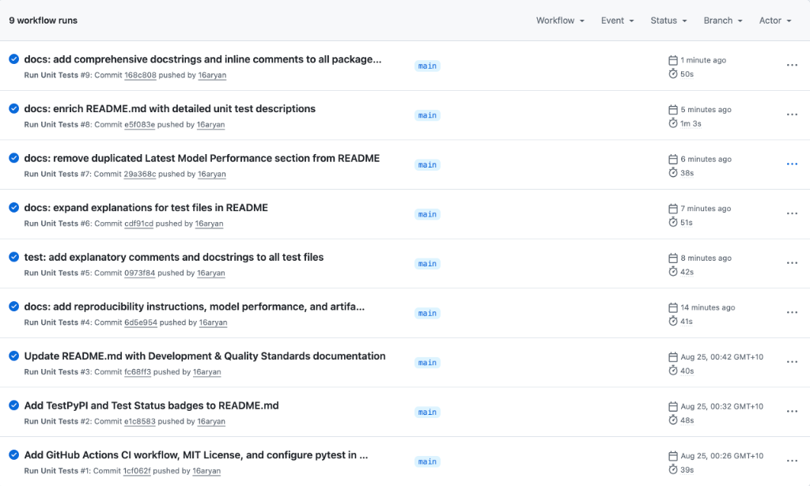

# nba_prep

[](https://test.pypi.org/project/nba-prep-26040826/0.4.0/)
[](https://github.com/16aryan/36120-26SP-group38-26040826-Python-package-Aryan-Goel/actions)

`nba_prep` is a multi-domain production Python utility package providing data preprocessing, feature engineering, and target derivation pipelines for collegiate player career longevity prediction (AT1) and Weather Intelligence forecasting (AT2 - Climate Comfort Index & Weather Hazard Category).

## Installation

To install this package locally for development:
```bash
pip install -e .
```

To install from TestPyPI:
```bash
pip install --index-url https://test.pypi.org/simple/ --extra-index-url https://pypi.org/simple/ nba_prep_26040826
```

## Features

- **Height Cleaning**: Converts height strings (e.g. `6-7`) to numeric inches.
- **Year Cleaning**: Cleans college year categories (`Fr`, `So`, `Jr`, `Sr`) into standard integers (1 to 4).
- **Age Extraction**: Computes player age during a college season from date of birth (DOB) and season year.
- **Basketball Analytics**: Calculates Advanced Basketball Metrics (e.g. Assist-to-Turnover ratio, True Shooting percentage, Defensive Impact score, and Offensive Rating interaction).
- **Cumulative Career Features**: Calculates running career totals, averages, season-by-season progression deltas, and peak career maximums to date for tracking player consistency.
- **Recruiting & Conference Features**: Imputes high school recruiting ranks, handles Power Conference binary indexing, and calculates pace-adjusted per-minute production metrics.
- **Decision Support & Scouting Reports**: Includes prospect classification into success probability tiers and automated scouting report card generators summarizing collegiate metrics for front-office decision-makers.
- **Model Evaluation & Financial ROI**: Computes technical evaluation metrics (AUPRC, AUROC, F1-optimized decision thresholds) and translates model probabilities into financial business ROI (wasted rookie contract cap space avoided, scouting travel cost savings).
- **Weather Intelligence (AT2 Extension)**: Calculates Climate Comfort Index (CCI) multi-horizon regression targets, Weather Hazard Category (WHC) multiclass classification targets, daily Open-Meteo temporal aggregations, cyclical solar calendar encodings, and strict no-leakage dry-streak counters.

## Usage

Here is a quick example of how to use the package:

```python
from nba_prep import clean_height, categorize_prospect, generate_scouting_report

# 1. Clean height data
height_inches = clean_height("6-7")  # returns 79.0

# 2. Categorize a prospect's probability score
tier = categorize_prospect(0.82)     # returns "Tier 1: Franchise Core (Elite)"

# 3. Generate a scouting report card
report = generate_scouting_report(
    "Aryan Goel", 
    bpm=9.2, 
    true_shooting=0.61, 
    defensive_impact=11.0, 
    rec_rank=15.0
)
print(report)

# 4. Calculate Climate Comfort Index (CCI - AT2)
from nba_prep.weather import calculate_climate_comfort_index, interpret_cci
cci, components = calculate_climate_comfort_index(
    temperature_2m=22.0, relative_humidity_2m=50.0,
    wind_speed_10m=10.0, cloud_cover=0.0, precipitation=0.0
)
print(f"CCI: {cci:.1f} ({interpret_cci(cci)})")

# 5. Calculate Weather Hazard Category (WHC - AT2)
from nba_prep.weather import calculate_weather_hazard_index, convert_whi_to_whc, interpret_whc
whi, hazards = calculate_weather_hazard_index(
    precipitation=15.0, wind_gusts_10m=50.0, cloud_cover=50.0,
    snowfall=0.0, temperature_2m=22.0
)
cat = convert_whi_to_whc(whi)
print(f"WHC: Class {cat} ({interpret_whc(cat)})")
```
--------
## Development & Quality Standards

### 1. Robust Unit Test Coverage
This package is fully verified by 20 unit tests distributed across 6 specialized test suites:
* **`test_cleaning.py`** — Validates basic data cleaning utility functions under [`src/nba_prep/cleaning.py`](file:///Users/aryan/AT1_AML/36120-26SP-group38-26040826-package/src/nba_prep/cleaning.py):
  * **`clean_height`**: Verifies that standard height strings (e.g. `"6-7"` to `79.0` and `"6-2"` to `74.0` inches) are correctly parsed, and checks that missing (`None`), malformed strings (e.g., `"invalid"`), or floats (e.g., `6.7`) return `NaN`.
  * **`clean_year`**: Checks the mapping of college year codes (`"Fr" -> 1`, `"So" -> 2`, `"Jr" -> 3`, `"Sr" -> 4`), conversion of numeric strings (e.g., `" 2.0 "` to integer `2`), and ensures invalid year codes return `NaN`.
  * **`calculate_age`**: Validates calculation of a prospect's age during a college season from birthdate strings (e.g. `"1997-10-15"` in `2020` yields `23.0`), and asserts that malformed date strings, `None` inputs, or missing season years return `NaN`.
* **`test_features.py`** — Validates advanced player feature math under [`src/nba_prep/features.py`](file:///Users/aryan/AT1_AML/36120-26SP-group38-26040826-package/src/nba_prep/features.py):
  * **`calculate_ast_tov_ratio`**: Tests standard assist-to-turnover ratio computations (e.g., `10` assists, `2` turnovers -> `5.0`), and verifies division-by-zero protection (e.g., `10` assists, `0` turnovers uses a default $1e-5$ epsilon, yielding `1,000,000.0`).
  * **`calculate_true_shooting_percentage`**: Asserts that True Shooting Percentage calculations match standard basketball analytics formula ($PTS / (2 \times (FGA + 0.44 \times FTA))$).
  * **`calculate_defensive_impact`**: Checks custom weighted defensive contributions ($1.5 \times Steals + 1.5 \times Blocks + 1.0 \times DefRebounds$).
  * **`calculate_scoring_efficiency`**: Asserts points production scaled by playing minutes percentage ($PTS / Min\%$).
  * **`calculate_advanced_recruit_and_conference_features`**: Uses a mock DataFrame to verify features like imputing missing recruiting ranks with a default average (`150.0`), setting binary recruiting rank existence indicators, flagging Power Conferences (e.g. ACC, Big Ten) vs mid-majors (e.g. WAC), and computing per-minute production rates.
* **`test_cumulative.py`** — Validates historical player-level tracking logic under [`src/nba_prep/features.py`](file:///Users/aryan/AT1_AML/36120-26SP-group38-26040826-package/src/nba_prep/features.py):
  * **`calculate_cumulative_features`**: Feeds a multi-season DataFrame for two distinct players (pid 1 and 2) to test grouped career historical progression. Asserts that the function correctly tracks sequential season counts (`career_season_num`), running totals (`cum_GP`, `cum_pts`), running averages (`cum_mean_bpm`, `cum_mean_usg`), career peak values to date (`max_pts_to_date`, `max_min_per_to_date`), and season-over-season progression deltas (`pts_progression`).
* **`test_analytics.py`** — Validates classification and descriptive scouting card logic under [`src/nba_prep/analytics.py`](file:///Users/aryan/AT1_AML/36120-26SP-group38-26040826-package/src/nba_prep/analytics.py):
  * **`categorize_prospect`**: Validates player draft prospects categorization into four discrete scouting categories:
    * *Tier 1: Franchise Core (Elite)* for probabilities >= 0.70
    * *Tier 2: Rotation Contributor (Moderate)* for 0.40 <= P < 0.70
    * *Tier 3: G-League / Development Project (Low-Moderate)* for 0.10 <= P < 0.40
    * *Tier 4: High Risk / Undrafted Profile (Very Low)* for P < 0.10
    * Asserts bounds checking for out-of-range probabilities (1.5 -> "Invalid Probability") and type mismatches.
  * **`generate_scouting_report`**: Validates the automated text card generator. Verifies that report descriptions contain appropriate qualitative descriptors based on statistics (e.g., asserts that an elite player report contains "Elite collegiate contributor", "Exceptionally efficient", and "Five-star high school recruit", while a bench player report prints "Below-average impact" and "Highly inefficient scorer").
* **`test_weather.py`** — Validates Weather Intelligence target derivations, aggregations, and feature calculations under [`src/nba_prep/weather.py`](src/nba_prep/weather.py):
  * **Climate Comfort Index (CCI)**: Tests individual component scores (temperature, humidity, wind, cloud, rain), boundary conditions (0-100), composite formula verification against ideal benchmark (100.0), and 5-tier descriptive mapping (`interpret_cci`).
  * **Weather Hazard Category (WHC)**: Asserts all 5 hazard equations (rain, wind gusts, cloud cover, snowfall, temperature), composite Weather Hazard Index (WHI), and strict 4-class categorical discretization (`convert_whi_to_whc`: 0=Low, 1=Moderate, 2=High, 3=Extreme).
  * **Hourly-to-Daily Aggregation**: Verifies Open-Meteo aggregation rules (daily mean for temperature/humidity/wind/cloud, daily sum for precipitation/snowfall, and daily max for wind gusts).
  * **Zero-Leakage Feature Engineering**: Confirms correct cyclical trigonometric calendar encodings (sine & cosine) and verifies strict backward shifting `shift(1)` for consecutive dry-streak days without temporal leakage.
* **`test_evaluation.py`** — Validates technical scoring metrics and business financial ROI outputs under [`src/nba_prep/evaluation.py`](file:///Users/aryan/AT1_AML/36120-26SP-group38-26040826-package/src/nba_prep/evaluation.py):
  * **`calculate_model_metrics`**: Confirms that model metric helper computes AUPRC, AUROC, base rate, and the optimal classification threshold (based on maximizing the F1-score) for a simulated prediction array.
  * **`estimate_draft_roi`**: Validates front-office financial models. Sets a decision threshold of 0.5 on a mock group of 10 prospects to assert total players drafted, successes, busts, draft success rate (e.g. 60.0% vs base rate of 30.0%), wasted salary cap dollars (e.g., 2 busts * $5,000,000 = $10,000,000), and percentage of travel and scouting hours saved (e.g. 50.0%). Also checks handling of high thresholds resulting in zero prospects drafted.

To execute tests locally, run:
```bash
pytest
```

### 2. Continuous Integration (CI) Pipeline
A GitHub Actions workflow is configured in `.github/workflows/test.yml` to automatically verify code integrity. On every push and pull request, the test runner:
* Spins up containerized environments across multiple Python versions (`3.10`, `3.11`, `3.12`, `3.13`).
* Installs dependencies, sets up the package, and executes the entire unit test suite.

#### Pipeline Run Execution & Status
The CI pipeline has run successfully across multiple iterations and code updates, verifying code standards, package builds, PyPI package structure, and full unit test compliance. Below is the record of the successful workflow runs demonstrating the validation:



### 3. Packaging & Standards Compliance
* **Pyproject Configuration (`pyproject.toml`)**: Structured with PEP 621 metadata, dependencies (`numpy`, `pandas`), development requirements (`pytest`, `pytest-cov`), and default pytest search paths.
* **Licensing (`LICENSE`)**: Distributed under the permissive open-source MIT License.
* **Git Hygiene (`.gitignore`)**: Configured to ensure compilation caches (`__pycache__`), build directories (`dist/`, `build/`), test reports, and IDE configurations are kept out of source control tracking.


--------
## Latest Model Performance & Credit

This training run was performed by **Aryan Goel (26040826)**.

### Performance Scores (OOF AUPRC)
* **LightGBM**: `0.48416`
* **Extra Trees**: `0.49197`
* **Logistic Regression**: `0.48983`
* **XGBoost**: `0.50970`
* **CatBoost**: `0.51188`
* **Blended Ensemble**: `0.52035`

### Generated Model Artifacts (`models/`)
* **LightGBM**: `models/final_lightgbm.joblib`, `models/final_lightgbm.txt`, `models/36120-26SP-group38-26040826-final_lightgbm.joblib`
* **XGBoost**: `models/final_xgboost.joblib`, `models/final_xgboost.json`, `models/36120-26SP-group38-26040826-final_xgboost.joblib`
* **CatBoost**: `models/final_catboost.joblib`, `models/final_catboost.cbm`, `models/36120-26SP-group38-26040826-final_catboost.joblib`
* **Experiment 3 Final Model**: `models/36120-26SP-group38-26040826-experiment3-model.joblib`
* **Predictions**: `submission.csv` (6,261 unique player rows, 0 duplicates, 0 nulls, ready for Kaggle submission)

--------

## Reproducibility Instructions

### 1. Install Environment & Package Dependencies
To set up the project environment and install all required machine learning libraries alongside the custom `nba_prep` feature engineering package:
```bash
pip install -r requirements.txt
```
*(Alternatively, install `nba_prep` directly from TestPyPI: `pip install --index-url https://test.pypi.org/simple/ --extra-index-url https://pypi.org/simple/ nba_prep_26040826==0.3.3`)*

### 2. Preprocess Raw Data & Generate Processed CSVs
To generate all fresh, cleaned, and feature-engineered datasets from raw inputs:
```bash
python -m AT1_AML.dataset
```
**Output Files Generated in `data/processed/`:**
* `train_processed.csv`: Cleaned multi-season training data with 110+ engineered features (cumulative statistics, True Shooting %, defensive impact, age, and recruit pedigree).
* `test_processed.csv`: Cleaned test set with aligned feature columns and zero missing feature values.
* `interim/` datasets: Intermediate cleaned and imputed tables.

### 3. Train Models, Output Metrics & Generate Predictions
Run the complete automated 5-Fold Stratified Group Cross-Validation and model training pipeline:
```bash
python -m AT1_AML.modeling.train
```
**What this accomplishes:**
1. **Cross-Validation Evaluation:** Evaluates 5 separate algorithms (LightGBM, XGBoost, CatBoost, Extra Trees, Logistic Regression) and their ensemble using Stratified Group K-Fold (grouped strictly by `pid` to eliminate data leakage).
2. **Generates Fresh Model Files in `models/`:** Fits final estimators on full peak-season data and saves serialized model weights:
   * **LightGBM:** `models/final_lightgbm.joblib`, `models/final_lightgbm.txt`, `models/36120-26SP-group38-26040826-final_lightgbm.joblib`
   * **XGBoost:** `models/final_xgboost.joblib`, `models/final_xgboost.json`, `models/36120-26SP-group38-26040826-final_xgboost.joblib`
   * **CatBoost:** `models/final_catboost.joblib`, `models/final_catboost.cbm`, `models/36120-26SP-group38-26040826-final_catboost.joblib`
   * **Final Ensemble Model:** `models/36120-26SP-group38-26040826-experiment3-model.joblib`
3. **Generates Deduplicated Kaggle Submission (`submission.csv`):** Evaluates test prospects strictly on their final college seasons, ensuring exactly 6,261 unique player IDs with zero duplicates and zero null values.

### 4. Running Experimental Walkthrough Notebooks
The complete, structured experimental progression is documented across three dedicated Jupyter notebooks:

* **Experiment 1 (Baseline Model):** `notebooks/36120-26SP-group38-26040826-AT1-experiment-1.ipynb`
  * Implements baseline LightGBM model, initial data exploratory checks, and saves `models/36120-26SP-group38-26040826-experiment1-model.joblib`.
* **Experiment 2 (Model Architecture Exploration):** `notebooks/36120-26SP-group38-26040826-AT1-experiment-2.ipynb`
  * Rigorous head-to-head comparison of Random Forest, HistGradientBoosting, and Tuned LightGBM. Saves `models/36120-26SP-group38-26040826-experiment2-model.joblib`.
* **Experiment 3 (Feature Selection & Ensembling):** `notebooks/36120-26SP-group38-26040826-AT1-experiment-3.ipynb`
  * Comprehensive feature engineering, correlation analysis, LightGBM gain-importance feature selection, and a 3-model GBDT ensemble. Generates processed split files (`X_train.csv`, `y_train.csv`, `X_val.csv`, `y_val.csv`, `X_test.csv`, `y_test.csv`), saves `models/36120-26SP-group38-26040826-experiment3-model.joblib`, and outputs the final blended `submission.csv`.

#### To re-execute all notebooks via CLI:
```bash
jupyter nbconvert --to notebook --execute --inplace notebooks/36120-26SP-group38-26040826-AT1-experiment-1.ipynb
jupyter nbconvert --to notebook --execute --inplace notebooks/36120-26SP-group38-26040826-AT1-experiment-2.ipynb
jupyter nbconvert --to notebook --execute --inplace notebooks/36120-26SP-group38-26040826-AT1-experiment-3.ipynb
```
*(Or launch interactively using `jupyter lab` or `jupyter notebook`).*

--------

